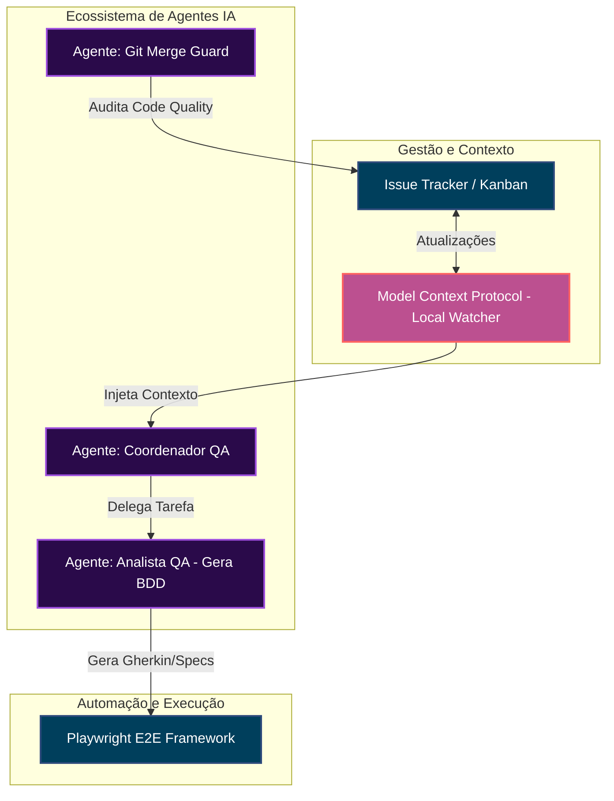
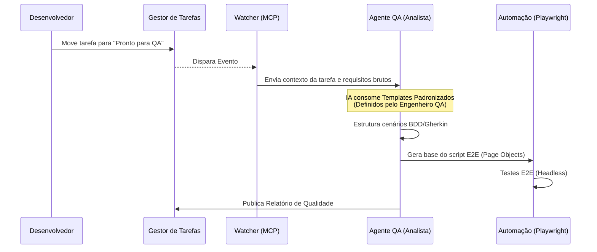
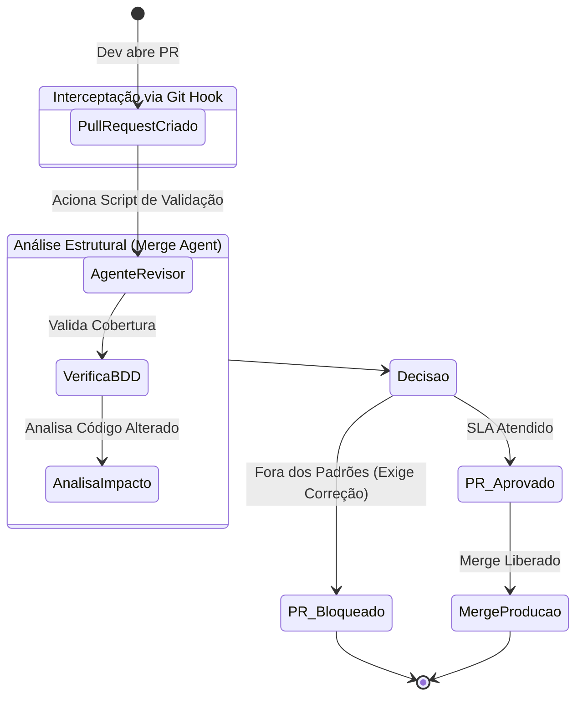

# 🚀 QA & AI Orchestration Architecture

Este repositório é um *Showcase* de Arquitetura de Testes focada em sistemas de alta complexidade logística e industrial. 

Com o crescimento exponencial da complexidade dos ecossistemas de software, o papel da Engenharia de Qualidade (QA) está em constante evolução. O objetivo desta arquitetura é demonstrar uma abordagem inovadora onde o QA atua como um orquestrador estratégico: **o Engenheiro (humano) foca em definir as regras de negócio, a arquitetura e os critérios de aceite, enquanto uma rede de agentes de Inteligência Artificial acelera o trabalho de estruturação, cobertura e codificação.**

## 💡 O Desafio
Em ecossistemas complexos (como ERPs, malha viária e automação fiscal), a precisão é crítica — um bug em produção pode impactar severamente a operação logística. Para garantir segurança em alto volume, os principais desafios técnicos que esta arquitetura resolve são:
- Escalar a criação de cenários BDD a partir de requisitos densos e complexos.
- Manter a padronização contínua nos artefatos de teste e documentação.
- Garantir validação rigorosa durante o processo de *Merge* e CI/CD, sem criar gargalos na velocidade de entrega do time de desenvolvimento.

## 🛠️ A Solução Construída
Desenvolvi uma esteira de Qualidade Aumentada (orquestrada por IA) que atua de forma integrada ao ciclo de vida do desenvolvimento.

### Principais Pilares:
1. **Model Context Protocol (MCP):** Agentes conectados diretamente ao Issue Tracker (e.g. Redmine/Jira), monitorando o board e atuando preventivamente no refinamento técnico.
2. **Templates Estritos:** A IA atua de forma controlada. Ela formata saídas baseadas em templates `.md` padronizados, definidos previamente pela Engenharia de QA.
3. **Git Merge Guard:** Interceptação real via Git Hooks, validando *Pull Requests* de acordo com os critérios de SLA de teste estabelecidos antes da aprovação.
4. **Playwright E2E:** Geração automatizada da estrutura base de testes *Page Object Model* (POM) orientada aos cenários BDD validados.

---

## 📊 Arquitetura do Ecossistema

### 1. Visão Macro: Orquestração de Agentes

### 2. O Fluxo Diário (Tarefas -> Automação)

### 3. CI/CD: Guardião do Repositório

## 📁 Estrutura deste Showcase
Explore as pastas acima para visualizar a arquitetura base do projeto (dados sensíveis e regras de negócios reais foram removidos por motivos de confidencialidade):
- `/templates`: Estrutura de padronização para as saídas da IA.
- `/agents`: Parâmetros e comportamentos definidos para cada agente especialista.
- `/scripts`: Shell scripts para integração com o sistema operacional e Git.
- `/playwright-base`: Estrutura de execução para a automação.